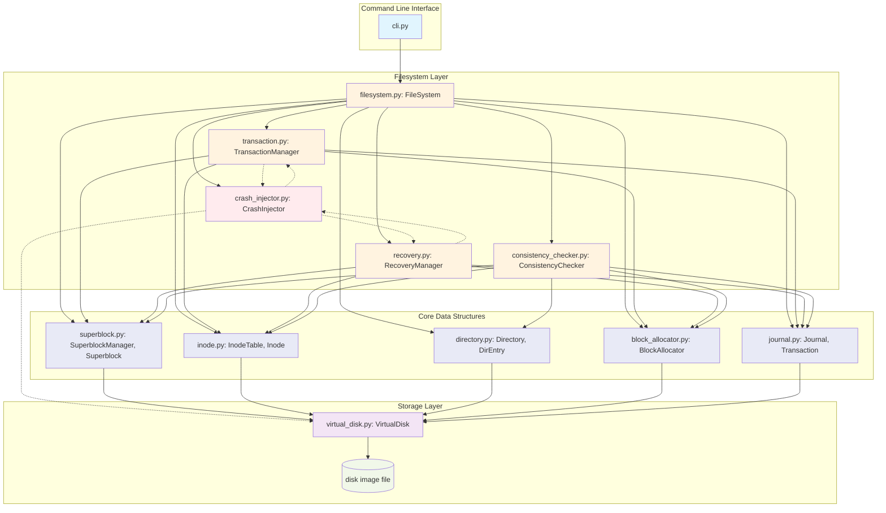

# Architecture Diagram

## Component Relationships

### Data Flow (Normal Operation)
1. **CLI** → **FileSystem** → **TransactionManager** → **Journal** (WAL)
2. **TransactionManager** tracks metadata changes
3. **Commit**: Journal → flush → Commit Record → flush → Home Blocks → flush → Checkpoint
4. **Recovery**: On mount, scan journal → replay committed transactions

### Crash Injection Points
- **VirtualDisk**: Before/after read/write/flush
- **TransactionManager**: Before/after journal write/flush/commit/apply/checkpoint
- **RecoveryManager**: During scan/replay

### Recovery Process
1. Read superblock, validate
2. Scan journal from checkpoint tail
3. Validate records (checksum, length, type)
4. Identify committed transactions (valid TRANS_COMMIT)
5. Replay committed transactions (idempotent)
6. Flush recovered metadata
7. Update checkpoint
8. Run consistency checker

### Consistency Checks
1. Superblock validation (magic, version, bounds, checksum)
2. Inode validation (type, size, blocks, links, timestamps)
3. Block allocation (bitmap vs inode references, no leaks)
4. Directory hierarchy (valid entries, no cycles, reachable)
5. Journal integrity (record structure, checksums)
6. Orphan detection (unlinked inodes, unreachable directories)